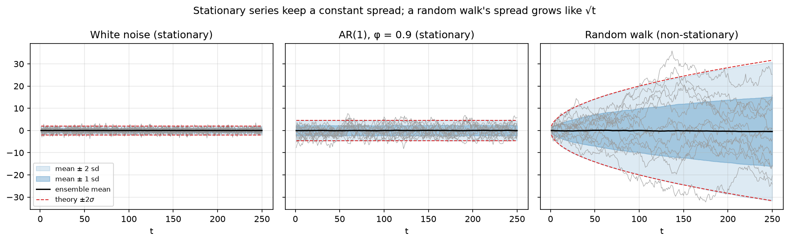
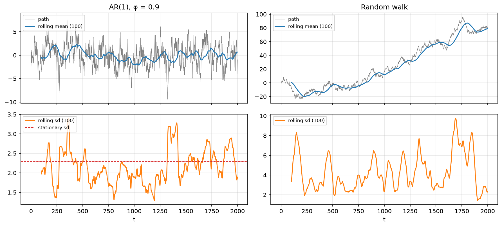
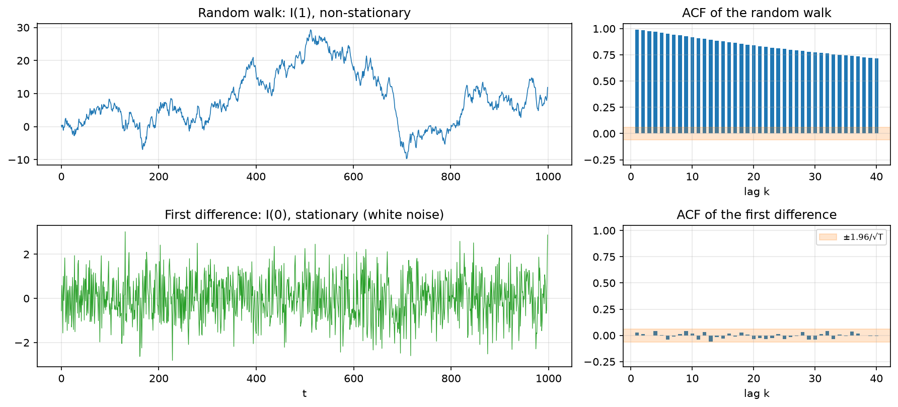
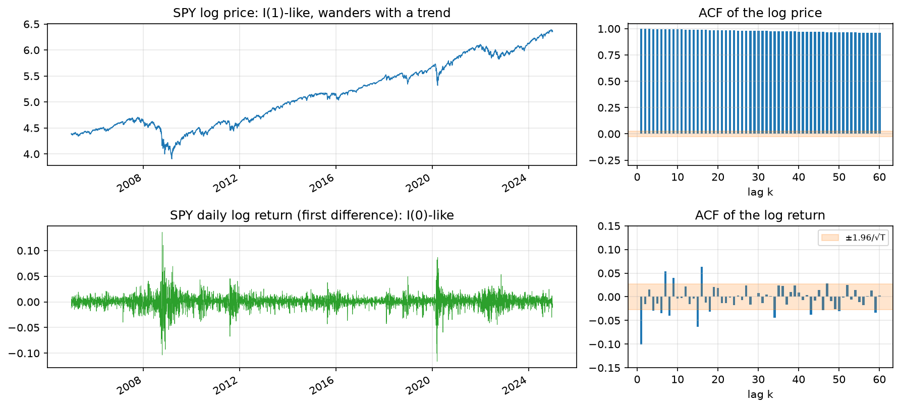

# Module 3 — Statistics toolkit: random walks, stationarity, regression

Statistical arbitrage rests on one question: *is this spread stationary?* In this module you simulate the three basic time series, see what separates a series that keeps coming back from one that wanders off, make a wandering series stationary by differencing, fit a regression with honest error bars, and walk into the main trap: regressing one random walk on another gives "significant" nonsense.

Notebook: [`notebook.ipynb`](notebook.ipynb). Code: [`statarb/simulate.py`](../../src/statarb/simulate.py), [`statarb/stats.py`](../../src/statarb/stats.py).

> [!TIP]
> **How to read these notes.** The numbered steps are the main path. Boxes are optional: notes and warnings are short asides; collapsed sections hold derivations, extra jargon and interview-level detail.

## Step 1. Simulate three basic processes and look at their memory

Let $\varepsilon_t$ be independent random shocks with mean 0 and variance $\sigma^2$ (**white noise** when taken on their own). Three processes built from them:

| Process | Definition | Memory | Physics picture |
|---|---|---|---|
| **White noise** | $x_t = \varepsilon_t$ | none | thermal noise |
| **AR(1)** | $x_t = c + \phi x_{t-1} + \varepsilon_t$ | decays as $\phi^k$ | particle in a harmonic trap |
| **Random walk** | $x_t = x_{t-1} + \mu + \varepsilon_t$ | permanent | free diffusion |

AR(1) is "autoregressive of order 1": each value remembers a fraction $\phi$ of the previous one. In the random walk, $\mu$ is the **drift**, a steady trend added each step.

```python
simulate.white_noise(500)
simulate.ar1(500, phi=0.9)
simulate.random_walk(500)
stats.acf(x, nlags=40)
```

The **autocorrelation function** (ACF), $\rho_k$, is the correlation of a series with itself $k$ steps earlier. For the simulated AR(1) with $\phi = 0.9$ the first sample autocorrelations are 0.91, 0.82, 0.74, 0.68, close to $0.9^k$.

**What it means:** the ACF is each process's fingerprint. White noise: nothing outside the band $\pm 1.96/\sqrt T$, where 95% of white-noise autocorrelations fall by chance. AR(1): geometric decay $\phi^k$, with **correlation time** $\tau = -1/\ln\phi \approx 9.5$ steps. Random walk: a sample ACF near 1 that decays only slowly, the signature of a **unit root** (Step 2).

<details>
<summary>The sample ACF, the white-noise band, the PACF, and the physics analogue</summary>

The sample autocorrelation at lag $k$ is

$$\hat\rho_k = \frac{\sum_{t=k+1}^{T}(x_t-\bar x)(x_{t-k}-\bar x)}{\sum_{t=1}^{T}(x_t-\bar x)^2}.$$

For independent data each $\hat\rho_k$ is roughly $\mathcal N(0, 1/T)$, hence the $\pm 1.96/\sqrt T$ band; about 1 lag in 20 falls outside it by chance.

The **partial autocorrelation function** (PACF) at lag $k$ is the correlation between $x_t$ and $x_{t-k}$ after removing the linear effect of the lags in between. For the AR(1) the PACF is 0.91 at lag 1 and essentially zero after, while the ACF decays slowly: only lag 1 matters directly.

*Physics analogy:* the ACF is the time-correlation function $\langle A(t)A(0)\rangle$ of statistical mechanics.

</details>

## Step 2. Watch the spread of an ensemble

One path can mislead, so simulate an **ensemble**: 2,000 independent paths of each process, and look at the spread across paths at each time.



**Figure 1.** 2,000 simulated paths of each process (12 shown in grey): ensemble mean (black), mean ± 1 and ± 2 standard deviations across paths (shaded) and the theoretical ± 2σ band (red dashes). The stationary series keep a constant mean and spread, ± 2 for white noise and ± $2/\sqrt{1-\phi^2} \approx 4.6$ for the AR(1). The random walk's spread grows like $2\sqrt t$: free diffusion.

**What it means:** this is the distinction everything in stat arb hinges on. A series is **stationary** if its statistical properties don't change over time: here, a constant mean and a constant spread. White noise and the AR(1) are stationary; the random walk is not, because its variance grows with time,

```math
\mathbb E[x_t] = x_0 + \mu t, \qquad \operatorname{Var}(x_t) = t\sigma^2 ,
```

like $\langle x^2\rangle = 2Dt$ for a diffusing particle. A stationary spread can be traded ("far from its mean, so likely to come back"); a random walk has no level to come back to.

> [!NOTE]
> *Physics analogy:* a particle in a harmonic trap (AR(1)) reaches equilibrium, where the pull back balances the kicks; a free particle (random walk) keeps diffusing away.

<details>
<summary>Weak stationarity, the AR(1)'s equilibrium, unit roots, and the link to the Ornstein–Uhlenbeck process</summary>

A process is **strictly stationary** if its joint distributions don't change when shifted in time. In practice we use **weak (covariance) stationarity**: a constant mean $\mu$, a constant variance $\gamma_0$, and an autocovariance $\operatorname{Cov}(x_t, x_{t-k}) = \gamma_k$ that depends only on the lag $k$.

For $\lvert\phi\rvert \lt 1$ the AR(1) settles into an equilibrium with

$$\mathbb E[x_t] = \frac{c}{1-\phi}, \qquad \operatorname{Var}(x_t) = \frac{\sigma^2}{1-\phi^2}, \qquad \rho_k = \phi^{k}.$$

Deriving the variance is Exercise 1.

At $\phi = 1$ the restoring force vanishes and the AR(1) becomes a random walk. That boundary case is a **unit root**, because the characteristic equation $1 - \phi z = 0$ then has its root at $z = 1$.

Module 6 shows that the AR(1) is the exact discretisation of the Ornstein–Uhlenbeck process, the overdamped Langevin equation $dX = -\theta X dt + \sigma dW$, with $\phi = e^{-\theta \Delta t}$.

</details>

## Step 3. Look at a single path with rolling statistics

In practice you see *one* path. A rolling window (here 100 steps) gives a local mean and standard deviation.



**Figure 2.** What one path shows, with a 100-step rolling window. The AR(1)'s rolling mean and standard deviation hover around fixed values. The random walk's rolling mean wanders off with the path and its rolling standard deviation swings widely, so "two standard deviations from the mean" has no fixed meaning.

**What it means:** for the AR(1), the past window's mean and standard deviation are a fair guide to the future, which is what a trading rule needs. For the random walk they describe only the stretch the window happened to cover.

> [!NOTE]
> The random walk's *rolling* standard deviation doesn't grow; it swings between about 2 and 10. What grows like $\sqrt t$ is the spread *across the ensemble* (Figure 1).

## Step 4. Make a random walk stationary by differencing

Take the **first difference**, $\Delta x_t = x_t - x_{t-1}$. For a random walk this gives back the shocks: $\Delta x_t = \mu + \varepsilon_t$.



**Figure 3.** Differencing turns an $I(1)$ series into an $I(0)$ one. Top: a random walk and its sample ACF, which decays slowly from about 1 (the unit-root signature). Bottom: its first difference, which is the white-noise shocks; every autocorrelation sits inside the $\pm 1.96/\sqrt T$ band.

**What it means:** a series is **integrated of order $d$**, written $I(d)$, if it must be differenced $d$ times to become stationary. Stationary series are $I(0)$; a random walk is $I(1)$.

## Step 5. Do the same with a real price



**Figure 4.** The same on real data, SPY 2005–2024. The log price behaves like an $I(1)$ series (ACF ≈ 1 at all lags shown). Its first difference, the daily log return, has almost no autocorrelation (lag 1 ≈ −0.10). Its mean is stable, but its variance clearly is not: volatility clusters.

```
lag                  1       2       3       4       5
log price       0.9993  0.9986  0.9979  0.9972  0.9965
return         -0.1003 -0.0157  0.0157 -0.0292 -0.0145
squared return  0.2767  0.4833  0.2473  0.2959  0.3190
```

**What it means:** log prices are approximately $I(1)$ and returns approximately $I(0)$. But the squared returns are strongly and persistently autocorrelated: big moves follow big moves. This is **volatility clustering**. Returns are nearly uncorrelated but *not independent*, because their variance is predictable. Variance that changes over time is called **heteroskedasticity** (constant variance: homoskedasticity); it comes back in Step 8.

> [!TIP]
> Most single prices aren't stationary. The hope of stat arb is that some *combinations* of prices are, for example $y - \beta x$ for two related stocks. That is cointegration (Module 5).

## Step 6. Fit a straight line by ordinary least squares

Simulate $y = 1 + 2x + \varepsilon$ with 100 points and fit $y = X\beta + \varepsilon$, where $X$ has a column of ones (the intercept) and a column of $x$ (the **regressor**). **Ordinary least squares** (OLS) picks the $\hat\beta$ that minimises the sum of squared **residuals** $e = y - X\hat\beta$:

```math
\hat\beta = (X^\top X)^{-1}X^\top y, \qquad \hat\sigma^2 = \frac{e^\top e}{n-k}, \qquad \widehat{\operatorname{Var}}(\hat\beta) = \hat\sigma^2(X^\top X)^{-1}.
```

```python
stats.ols(y, x).table()
```

| | coef | std_err | t | p_value |
|---|---|---|---|---|
| const | 1.0112 | 0.1499 | 6.74 | 1.1e-09 |
| x | 2.1557 | 0.1371 | 15.72 | 1.5e-28 |

$R^2 = 0.716$. The NumPy formulas above and `statsmodels` agree to every digit.

**What it means:** the **standard error** (std_err) is the error bar on each coefficient; the **t-statistic** is the estimate divided by its standard error, i.e. how many error bars it is from 0; $R^2$ is the fraction of the variance of $y$ the line explains. Both coefficients are within about one error bar of the truth (1 and 2).

> [!NOTE]
> *Physics analogy:* a $\chi^2$ fit with equal, uncorrelated error bars. The standard errors come from the curvature of $\chi^2$ at its minimum.

<details>
<summary>Derivation, assumptions, and what every line of the statsmodels summary means</summary>

Setting the gradient of $\lVert y - X\beta\rVert^2$ to zero gives the normal equations $X^\top X\hat\beta = X^\top y$, hence the formula above. The standard error of coefficient $j$ is the square root of the $j$-th diagonal entry of $\widehat{\operatorname{Var}}(\hat\beta)$, and $t_j = \hat\beta_j / \mathrm{SE}(\hat\beta_j)$. Also $R^2 = 1 - \sum e_t^2 / \sum (y_t - \bar y)^2$.

**Assumptions behind the textbook error bars:** the errors have mean zero given $X$ (**exogeneity**: no omitted variable or reverse causation correlated with $X$); they are uncorrelated with each other and have constant variance; and, for exact small-sample t-distributions, they are Gaussian. Under the first two, OLS is the best linear unbiased estimator (Gauss–Markov theorem).

The `statsmodels` summary also reports: a 95% confidence interval per coefficient; adjusted $R^2$ (penalised for the number of regressors); the F-statistic (all slopes zero together); log-likelihood, AIC and BIC (for comparing models, Module 10); Durbin–Watson (about 2 if residuals are uncorrelated, near 0 if strongly positively correlated); Omnibus and Jarque–Bera (are the residuals Gaussian?); and the condition number (large values warn of nearly collinear regressors).

</details>

## Step 7. Check what a hypothesis test promises

Test $H_0: \beta = 0$ ("no relationship") at the 5% level, over 2,000 simulations each:

| | n = 50 | n = 500 |
|---|---|---|
| true $\beta = 0$: share rejected (false positives) | 5.4% | 5.6% |
| true $\beta = 0.2$: share rejected (power) | 27% | 99% |

**What it means:** the **null hypothesis** $H_0$ is the default claim; the **p-value** is the probability, if $H_0$ were true, of a result at least as extreme as the one observed; we reject when it is below the **significance level** (5%). A valid test rejects a true null 5% of the time, whatever the sample size: that is the **type I error** rate (false positive). The **power** is the probability of rejecting a false null; failing to reject it is a **type II error** (false negative). Power grows with the sample size.

> [!WARNING]
> A p-value of 0.03 does **not** mean "a 3% chance the null is true", and $1 - p$ is not the probability the effect is real. It means data this extreme would occur 3% of the time if there were no effect, *and* only if the test's assumptions hold. The next two steps break those assumptions.

## Step 8. See error bars lie, and widen them with HAC

Repeat the false-positive experiment with a persistent regressor and persistent errors, both AR(1) with $\phi = 0.9$, independent of each other ($T = 300$, so the true slope is still 0):

```
false-positive rate at a nominal 5%: textbook SE 54%, HAC SE 24%
```

**What it means:** 300 autocorrelated observations carry much less information than 300 independent ones. The textbook formula doesn't know that, so its error bars are too small and it "finds" a relationship half the time. **HAC** standard errors (heteroskedasticity- and autocorrelation-consistent, also called **Newey–West**) add the covariance between nearby residuals back in and cut the rate by more than half. Use them by default for time-series regressions (`stats.ols(y, x, cov_type="HAC")`), and still distrust p-values from very persistent data.

<details>
<summary>The Newey–West "sandwich" formula, and why HAC still falls short here</summary>

$$\widehat{\operatorname{Var}}(\hat\beta) = (X^\top X)^{-1} \hat S (X^\top X)^{-1}, \qquad \hat S = \sum_{\lvert j\rvert \le L} w_j \sum_t e_t e_{t-j} x_t x_{t-j}^\top ,$$

with weights $w_j = 1 - \lvert j\rvert/(L+1)$ that fade out the covariance between residuals up to $L$ lags apart. The project's default bandwidth is $L = \lfloor 4(T/100)^{2/9}\rfloor$, which is 5 for $T = 300$. That is short compared with the correlation time of about 10 steps, and HAC is only exact as $T \to \infty$, so the false-positive rate stays well above 5%.

</details>

## Step 9. Regress one random walk on another

Now the main trap. Take two *independent* random walks of 500 steps and regress one on the other, 1,000 times. There is no relationship, so a 5% test should reject 5% of the time.

```
share with |t| > 1.96: 89% (should be 5%)
with HAC errors:       76%
median |t| = 9.4;  share with R² > 0.5: 15%
```

More data makes it worse:

| T | share with $\lvert t\rvert \gt 1.96$ | median $\lvert t\rvert$ |
|---|---|---|
| 100 | 76% | 4.6 |
| 500 | 90% | 10.1 |
| 2000 | 96% | 20.4 |

**What it means:** this is **spurious regression** (Granger and Newbold, 1974): unrelated non-stationary series look strongly related, with large t-statistics and often a large $R^2$, and the t-statistic grows like $\sqrt T$. Regressing one price on another and trusting the t-statistic is exactly this mistake. HAC barely helps, because the problem is the model, not the error-bar formula.

The cures are to difference the data first (regress returns on returns, both $I(0)$; Exercise 2), or to test whether the *residual* $y - \beta x$ is stationary, which is cointegration (Module 5).

<details>
<summary>Why it happens (Phillips, 1986), and the diffusion picture</summary>

When $y$ and $x$ are independent $I(1)$ series, the regression residual $y_t - \beta x_t$ is itself a random walk for every $\beta$, so every OLS assumption about the errors fails. Phillips showed that $\hat\beta$ then converges to a *random variable* rather than to 0, that $R^2$ doesn't go to 0, and that the t-statistic diverges at rate $\sqrt T$.

*Physics analogy:* two independent diffusing particles. Over any finite window both wander far, so their trajectories look correlated, and the sample correlation of two independent random walks has a broad distribution that doesn't shrink as the window grows.

</details>

## Step 10. Exercises

Do these in the empty cells at the end of the notebook. Your answers aren't written here.

1. **AR(1) stationary variance.** Derive $\operatorname{Var}(x_t) = \sigma^2/(1-\phi^2)$ for a stationary AR(1), and check it on a simulated ensemble.
2. **Differencing cures spurious regression.** Regress the *differences* of two independent random walks on each other (1,000 pairs) and show that the t-statistics now follow the nominal distribution, with about 5% beyond ±1.96.
3. **Estimating $\phi$ near a unit root.** For $\phi \in \lbrace 0.5, 0.9, 0.99, 1.0\rbrace$ and 250 observations, estimate $\phi$ by regressing $x_t$ on $x_{t-1}$, over many simulations. How biased and how noisy is $\hat\phi$ as $\phi \to 1$? Why does this matter for deciding whether a spread is mean-reverting?

**Done when:** you can sketch by hand what the ACF of a random walk, an AR(1) and white noise look like, and explain the spurious-regression table.

<details>
<summary>Interview questions (5), with key points</summary>

Write your own answer first, then open the key points.

**1. What is stationarity, and why does it matter for trading?**

<details>
<summary>Key points</summary>

Weak stationarity: constant mean and variance, and autocovariance depending only on the lag. Statistics estimated from the past then apply to the future, so "far from the mean" implies an expected move back towards it. A mean-reversion strategy needs a stationary spread; a non-stationary one can drift away forever. Physics: equilibrium vs diffusion.

</details>

**2. What is a unit root? Are prices or returns stationary?**

<details>
<summary>Key points</summary>

$\phi = 1$ in $x_t = \phi x_{t-1} + \varepsilon_t$: shocks never decay, so the variance grows like $t$; the series is a random walk, which is $I(1)$. Log prices are approximately $I(1)$ (ACF ≈ 1 at all lags); returns are approximately $I(0)$ (ACF ≈ 0), though their volatility clusters. Testing for a unit root is hard near $\phi = 1$ (Exercise 3; the ADF test in Module 5).

</details>

**3. Explain spurious regression. Why can't you regress price on price and trust the t-stat?**

<details>
<summary>Key points</summary>

Independent $I(1)$ series regressed on each other give $\lvert t\rvert \gt 1.96$ about 90% of the time (500 points), with high $R^2$, getting worse as $T$ grows (t ∝ √T). The residual is non-stationary, so the OLS error assumptions fail and $\hat\beta$ doesn't converge to the truth (Granger–Newbold 1974; Phillips 1986). Fix: difference the data, or test the residual for stationarity (cointegration).

</details>

**4. What does a p-value of 0.03 mean, and what does it *not* mean?**

<details>
<summary>Key points</summary>

If the null were true (and the model assumptions hold), data at least this extreme would occur 3% of the time. It is not the probability the null is true, not the probability the result is a fluke, and says nothing about effect size. It is only valid if the test's assumptions hold (spurious regression gives tiny p-values for nothing), and running many tests inflates false positives (Module 8).

</details>

**5. What is volatility clustering, and how would you detect it?**

<details>
<summary>Key points</summary>

Periods of high volatility persist: big moves follow big moves. Returns themselves are nearly uncorrelated, but squared or absolute returns have large, slowly decaying autocorrelation (SPY: 0.25–0.5 at short lags, still positive after 60 days). Detect with the ACF of squared returns, a Ljung–Box test on squared returns, or rolling volatility; model it with GARCH. Consequences: heteroskedastic regression errors (use HAC), time-varying risk, wider error bars than i.i.d. formulas suggest.

</details>

</details>

<details>
<summary>Glossary of terms in this module</summary>

| Term | Meaning |
|---|---|
| White noise | Uncorrelated shocks with mean 0 and constant variance |
| AR(1) | Autoregressive process of order 1: $x_t = c + \phi x_{t-1} + \varepsilon_t$ |
| Random walk / drift | $x_t = x_{t-1} + \mu + \varepsilon_t$; shocks accumulate forever / the constant step $\mu$ |
| ACF / PACF | Autocorrelation function / partial autocorrelation function (net of the lags in between) |
| Correlation time | $-1/\ln\phi$ for AR(1): how long memory lasts |
| Ensemble | Many independent simulated paths of the same process |
| Stationarity (weak) | Constant mean and variance; autocovariance depends only on the lag |
| Unit root | $\phi = 1$ in an AR model: no pull back, the series is a random walk |
| Integration order, $I(0)$ / $I(1)$ | Number of differences needed to make a series stationary |
| Volatility clustering | Big moves follow big moves; squared returns are autocorrelated |
| Heteroskedasticity | Variance that changes over time (opposite: homoskedasticity) |
| OLS | Ordinary least squares: minimise the sum of squared residuals |
| Regressor / residual | An explanatory variable / observed minus fitted value |
| Standard error / t-statistic | The error bar on an estimate / the estimate divided by it |
| $R^2$ | Fraction of the variance of $y$ explained by the regression |
| Null hypothesis / p-value / significance level | The default claim / probability under it of a result this extreme / the rejection threshold |
| Type I / type II error; power | False positive / false negative; probability of rejecting a false null |
| HAC / Newey–West standard errors | Error bars robust to heteroskedasticity and autocorrelation |
| Spurious regression | A "significant" regression between unrelated non-stationary series |

</details>

<details>
<summary>References and further reading</summary>

- Hyndman & Athanasopoulos, *Forecasting: Principles and Practice* (3rd ed.), Chapters 2 and 9.1–9.3 (free online).
- Wooldridge, *Introductory Econometrics*, Chapters 2–4 (OLS and inference) and 10–11 (time-series regression).
- Granger & Newbold, "Spurious regressions in econometrics", *Journal of Econometrics* 2(2) (1974).
- Phillips, "Understanding spurious regressions in econometrics", *Journal of Econometrics* 33(3) (1986).
- Newey & West, "A simple, positive semi-definite, heteroskedasticity and autocorrelation consistent covariance matrix", *Econometrica* 55(3) (1987).

</details>
