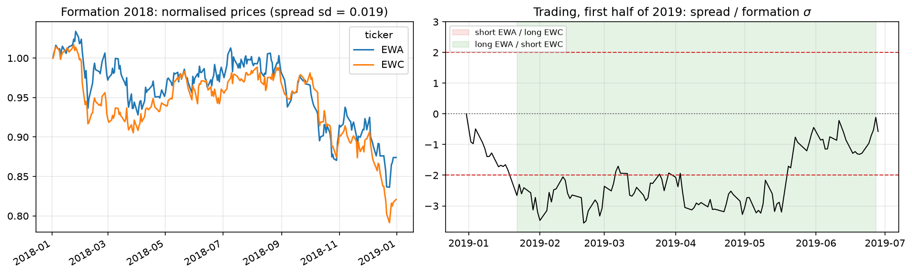
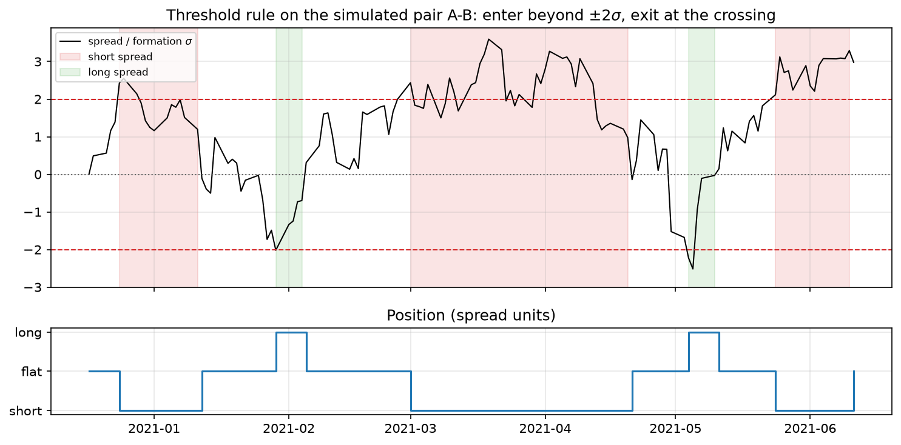
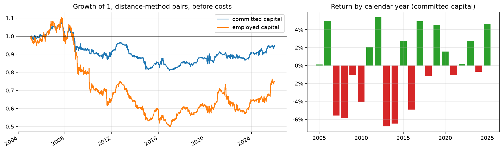
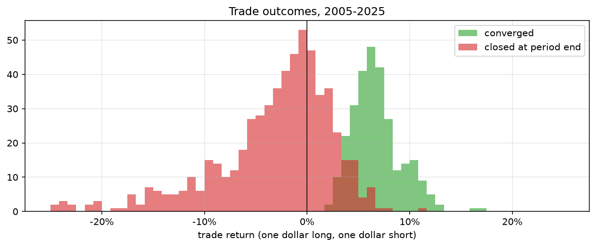

# Module 4 — Distance-method pairs trading

This is the canonical academic pairs strategy (Gatev, Goetzmann and Rouwenhorst, 2006; "GGR") and the benchmark every later method is compared against. It needs no econometrics: put prices on a common scale, pair up the stocks whose prices stayed closest, and bet that a pair which drifts apart will come back together. You build it step by step, check it on simulated data where it must work, then run it on twenty years of real prices, before costs. The result is close to zero, and seeing why is the main lesson.

Notebook: [`notebook.ipynb`](notebook.ipynb). Code: [`statarb/pairs/distance.py`](../../src/statarb/pairs/distance.py), [`statarb/signals.py`](../../src/statarb/signals.py).

> [!TIP]
> **How to read these notes.** The numbered steps are the main path. Boxes are optional: notes and warnings are short asides; collapsed sections hold derivations, extra jargon and interview-level detail.

## Step 1. Put every price on the same scale

```python
distance.normalise(prices)  # each column divided by its first price
```

Divide each price series by its first value, $p_t = P_t / P_0$, so every series starts at 1. Since prices are adjusted closes, $p_t$ is the growth of one dollar invested at the start (a **cumulative total-return index**).

**What it means:** a 40-dollar stock and a 400-dollar stock can now be compared directly: if they track each other, their normalised prices lie on top of each other.

## Step 2. Measure how far apart two stocks are

The **distance** between stocks $a$ and $b$ over a window of $T$ days is the sum of squared deviations (SSD) of their normalised prices:

```math
\mathrm{SSD}_{ab} = \sum_{t=1}^{T} \big(p_t^{a} - p_t^{b}\big)^2 .
```

On one simulated year with a genuine pair (A, B: a shared trend plus a mean-reverting gap), an impostor (D: the same trend plus slow independent drift) and an unrelated stock (C):

| | A | B | C | D |
|---|---|---|---|---|
| A | | 0.17 | 4.34 | 0.34 |
| B | 0.17 | | 3.90 | 0.31 |

**What it means:** the genuine pair is closest, the unrelated stock is far away, and the impostor is close too. Over a year D stays near A and B even though its gap to them is a random walk that never comes back.

> [!WARNING]
> SSD measures how close two prices *were*, not whether they are pulled back together. The method can't tell a genuine pair from an impostor, and that limitation shows up in every result below.

## Step 3. Pick the closest pairs in a formation period

```python
distance.select_pairs(prices.loc["2018"], n=20)
```

GGR use a 12-month **formation period** to choose pairs and the following 6-month **trading period** to trade them. Here the universe is U1 (SPY, the sector ETFs and the classic pairs) plus the twelve financials of U2: 34 tickers, so 561 possible pairs. The closest in 2018:

| | a | b | SSD |
|---|---|---|---|
| 1 | XLK | XLY | 0.074 |
| 2 | XLF | XLI | 0.099 |
| 3 | EWA | XLB | 0.113 |
| 6 | BAC | XLF | 0.142 |
| 7 | EWA | EWC | 0.161 |

**What it means:** the closest pairs are mostly ETF against ETF, or an ETF against one of its large holdings (BAC is in XLF). Minimising distance favours assets whose prices hardly ever separate. A ticker without a full formation history (XLC before 2019, for example) simply isn't eligible.

> [!NOTE]
> **Pairs trading** means holding one asset long and a related one short, betting on their *relative* price: a **relative-value** trade. When the bet is that a price gap will close, it is a **convergence trade**.

## Step 4. Watch the spread during the trading period

At the start of the trading period both legs are re-normalised to 1. The **spread** is the gap between them, measured in units of its standard deviation $\sigma$ during the formation period:

```math
z_t = \frac{p_t^{a} - p_t^{b}}{\sigma_{\text{formation}}} .
```



**Figure 1.** One classic pair, EWA (Australia) and EWC (Canada). Left: their normalised prices in the 2018 formation year, which stay close (the spread's standard deviation is 0.019). Right: the spread in units of that σ during the first half of 2019, with the ±2σ entry levels (red dashes); shading marks an open position.

**What it means:** in late January the spread fell below −2σ (EWA cheap relative to EWC), so the rule bought EWA and sold EWC short. The spread recovered most of the way, to about −0.5σ, but never crossed zero, so the trade was closed when the period ended in June: about +4% before costs.

## Step 5. Trade with a threshold rule

```python
position = threshold_positions(z, entry=2.0, exit=0.0)
```

| State | Rule |
|---|---|
| flat | open **short the spread** (−1: short $a$, long $b$) if $z_t \gt 2$; open **long** (+1) if $z_t \lt -2$ |
| short | close when $z_t \le 0$ (the spread has crossed back) |
| long | close when $z_t \ge 0$ |

Every open position is closed at the end of the trading period, converged or not.



**Figure 2.** The rule on the simulated pair A–B. Top: the spread in units of formation σ, with the entry levels at ±2 (red dashes) and the exit level at 0 (dotted); shading marks open positions. Bottom: the position.

**What it means:** **opening** a position means entering both legs; **closing** means exiting both; one open plus one close is a **round trip**. The gap between the entry level (2) and the exit level (0) is **hysteresis**: once open, the position stays open until the spread has come all the way back, instead of flickering on and off around one level.

> [!NOTE]
> *Physics analogy:* a Schmitt trigger, a comparator with two thresholds that switches on at one level and off at another, so that noise around a single threshold can't make it chatter.

<details>
<summary>The state machine exactly, and why it is causal</summary>

At most one transition happens per day: a position closed on day $t$ can reopen on day $t+1$ at the earliest, even if the spread jumped straight through zero to the other side. A missing spread (a leg with no price) closes the position. The rule looks only at past and present values of $z$, so it passes the truncation test from Module 2, and the test suite checks this (`tests/test_signals.py`).

The general rule `threshold_positions(z, entry, exit)` closes shorts at $z \le e$ and longs at $z \ge -e$, where $e$ is the exit level. Module 6 adds stop-losses and time limits to it.

</details>

## Step 6. Turn positions into returns

A position $s_t$ (in spread units) decided at day $t$'s close earns the next day's return on one dollar long $a$ and one dollar short $b$:

```math
r_t = s_{t-1}\,\big(R_t^{a} - R_t^{b}\big).
```

With 20 pairs there are two ways to state the strategy's return, both from GGR:

- **return on committed capital:** the average over all 20 pairs, counting a pair with no open position as earning zero (the money was set aside anyway);
- **return on employed capital:** the average over only the pairs that hold a position that day.

**What it means:** committed capital is the conservative, investable number; employed capital shows what an open trade earns. Here on average 9.5 of the 20 pairs are open, so the two differ by roughly a factor of two.

> [!WARNING]
> This P&L is deliberately naive: no **transaction costs** (the bid–ask spread, commissions), no **borrow fee** for the short leg, and the legs are rebalanced to one dollar each every day. Module 7 replaces it with a proper backtester and Module 8 adds costs. Every number in this module is therefore an upper bound.

<details>
<summary>Details of the P&L: dollar neutrality, GGR's version, and the timing convention</summary>

One dollar long and one dollar short makes each pair **dollar-neutral** (Module 1), but not necessarily beta-neutral: XLF against BAC, for instance, has different market sensitivities.

GGR hold the legs buy-and-hold during a trade (the dollar amounts drift with prices) and compute excess returns on committed and employed capital per six-month period. Rebalancing daily, as here, changes the numbers a little but not the conclusions, and keeps the code transparent.

Timing: `pair_returns(position, Ra, Rb, lag=1)` multiplies the position decided at day $t$'s close by day $t+1$'s return. `lag=2` waits a full day before trading (Step 10).

</details>

## Step 7. Check it on a simulated pair first

Run the full rolling procedure on three simulated years (the genuine pair, the impostor and the unrelated stock), selecting the top two pairs each time:

```
simulated, committed capital:  annual return 12.3%,  volatility 8.3%,  Sharpe 1.49
```

**What it means:** when the spread really is mean-reverting, the method works: 7 of the 9 A–B trades converge, with profits of 5–10%. Whenever an impostor pair (A–D or B–D) is selected, its trades mostly end only when the trading period runs out, with small gains or losses. The real data is a mix of both kinds, in unknown proportions.

## Step 8. Roll it through 2005–2025

```python
result = distance.ggr_backtest(prices, formation=252, trading=126, n_pairs=20, entry=2.0)
```

Every six months: select the 20 closest pairs on the previous twelve months, trade them for six months, close everything, repeat. That gives 42 trading periods and 872 round trips.

| Before costs, 2005–2025 | annual return | annual volatility | Sharpe ratio |
|---|---|---|---|
| committed capital | −0.2% | 4.4% | −0.04 |
| employed capital | −1.0% | 9.0% | −0.11 |



**Figure 3.** Left: growth of one dollar on committed and employed capital, before costs. Right: return on committed capital in each calendar year.

| Sub-period | annual return | Sharpe ratio |
|---|---|---|
| 2005–2009 | −1.4% | −0.27 |
| 2010–2014 | −2.0% | −0.48 |
| 2015–2019 | +1.2% | 0.39 |
| 2020–2025 | +1.3% | 0.27 |

**What it means:** on this universe the distance method earns essentially nothing before costs over twenty years. It lost money through the financial crisis and the early 2010s and made a little since 2015, and every sub-period's Sharpe ratio is small. The **Sharpe ratio** (annual return over annual volatility; Module 7) is a rough signal-to-noise ratio, and none of these values is clearly distinguishable from zero.

## Step 9. See how trades end



**Figure 4.** Returns of all 872 round trips, 2005–2025. Green: the spread crossed zero (converged). Red: the position was still open when the six-month period ended.

| | trades | mean return | median return |
|---|---|---|---|
| converged | 282 | +6.8% | +6.5% |
| closed at period end | 590 | −3.5% | −1.9% |

**What it means:** the strategy is a race between convergence and divergence. Converged trades win by construction, but only 32% of trades converge within six months (median holding period 55 days). The rest are closed after the spread kept diverging, and on average they lose. Pairs that *were* close in the formation year often behave like the impostor of Step 2 in the trading period.

## Step 10. Trade at the signal close, or wait one day?

The signal uses a closing price, and a closing trade happens at either the bid or the ask. A close that looks "far from the mean" may partly be **bid–ask bounce**: prices alternating between bid and ask, which reverses by itself the next day and fakes mean reversion. GGR therefore waited one day before trading.

| Before costs, committed capital | annual return | Sharpe ratio |
|---|---|---|
| trade at the signal close (`lag=1`) | −0.2% | −0.04 |
| wait one day (`lag=2`) | −0.3% | −0.07 |

**What it means:** waiting costs a little here. For liquid ETFs and large banks the bid–ask spread is a fraction of a basis point, so the bounce is tiny. In GGR's sample of all US stocks from 1962 on, with much wider spreads, it mattered more, which is why they report the conservative version.

## Step 11. Read the result honestly

The distance method on this universe makes roughly zero *before* costs, so it loses money after them. That is consistent with the literature: Do and Faff (2010) found that the method's profits fell sharply after the 1990s, and pairs trading on liquid US stocks has mostly stopped paying since the 2000s. Three reasons visible in this module:

1. **Selection by closeness, not by reversion.** SSD can't tell a genuine pair from an impostor (Steps 2 and 9).
2. **Small spreads.** The closest pairs barely move apart, so even converged trades earn only a few percent.
3. **Competition.** A strategy published in 1999 (working paper) and 2006 (journal) is crowded by everyone who read it.

> [!WARNING]
> Every choice made here (12 and 6 months, 20 pairs, 2σ, this universe) is a degree of freedom. Trying variants and keeping the best one is **data snooping**: the best of many backtests looks good by chance. Exercise 1 is your first encounter with it; Module 8 corrects for it.

> [!NOTE]
> **Interview checkpoint 1.** You should now be able to give a 2-minute and a 10-minute explanation of the project so far: data and its pitfalls (Modules 1–2), why stationarity matters (Module 3), and this strategy with its honest result.

<details>
<summary>Why pairs could work at all: the Law of One Price, liquidity provision, and differential measurement</summary>

- **Law of One Price:** close substitutes should trade at similar prices. If Coca-Cola and PepsiCo face the same economic shocks, a large gap between their returns is more likely to be temporary news or order flow than a permanent change.
- **Who is on the other side?** Mostly traders who need to buy or sell quickly and push one price away from its partner. The pairs trader provides **liquidity** (Module 1) and is paid for it when the gap closes. That payment shrinks as more traders compete to provide it.
- **Statistical arbitrage vs arbitrage:** true **arbitrage** is a riskless profit from a price inconsistency. **Statistical arbitrage** is many small bets that are favourable only on average; any single pair can diverge forever (a merger, a bankruptcy, a change of business model).
- *Physics analogy:* differential measurement. Subtracting two signals with a large common-mode component (the market and the sector) leaves the small relative signal, as in a differential amplifier or a Wheatstone bridge.

</details>

<details>
<summary>What GGR found, and how this version differs</summary>

GGR used all liquid US stocks from 1962 to 2002 (the CRSP database), formed pairs on 12 months and traded them for 6, started a new portfolio every month (six overlapping portfolios at any time), and waited one day before trading. Their top-20 pairs earned average annualised excess returns of up to about 11% before costs, and they showed the profits were not explained by standard risk factors or by bid–ask bounce alone.

This module differs in four ways: a small universe dominated by ETFs; 2005–2025 instead of 1962–2002; non-overlapping six-month periods; and daily-rebalanced legs. The broad lessons (the race between convergence and divergence, the decline over time) are the same as in the later literature (Do and Faff, 2010; Krauss, 2017).

</details>

## Step 12. Exercises

Do these in the empty cells at the end of the notebook. Your answers aren't written here.

1. **Thresholds.** Vary the entry threshold (1, 1.5, 2, 3σ) and count the trades and the average return per trade. Note that this is your first data-snooping risk (it gets formalised in Module 8).
2. **Same sector only.** Restrict pairs to the same sector, against allowing any pair. Which works better, and why might that be?
3. **What SSD rewards.** Explain in words why minimising SSD selects pairs with *low spread variance*, which may limit the profit per trade. (This is a known critique.)

**Done when:** the rolling backtest runs end to end, and you can explain each number in its results tables.

<details>
<summary>Interview questions (5), with key points</summary>

Write your own answer first, then open the key points.

**1. Walk me through the GGR distance method.**

<details>
<summary>Key points</summary>

Formation (12 months): normalise adjusted prices to start at 1, compute the SSD between every pair, pick the 20 smallest. Trading (next 6 months): re-normalise, open a dollar-neutral position (long the cheap leg, short the rich one) when the spread exceeds 2 formation standard deviations, close when it crosses zero or at the end of the period. Report returns on committed and on employed capital; roll every six months (GGR: every month, overlapping).

</details>

**2. Why do pairs selected by SSD not necessarily mean-revert?**

<details>
<summary>Key points</summary>

SSD measures past closeness, not a restoring force. Two stocks driven by the same trend plus independent random drift can stay close for a year by chance and then drift apart for good; nothing in SSD tests whether the spread is stationary. In our backtest only 32% of trades converged within six months. Cointegration (Module 5) and the half-life of mean reversion (Module 6) address this. SSD also favours pairs whose spread barely moves, which limits the profit per trade.

</details>

**3. What is the economic story for why pairs trading could make money? Who is on the other side of the trade?**

<details>
<summary>Key points</summary>

Law of One Price for close substitutes; temporary divergences caused by liquidity demand, overreaction or news that affects one leg only. The other side is usually a trader who needs immediacy, so the pairs trader is paid for providing liquidity. The risk is that the divergence is permanent (fundamental news, a merger), and the premium shrinks as competition grows.

</details>

**4. Why did GGR wait one day after the signal?**

<details>
<summary>Key points</summary>

Bid–ask bounce. A closing price is either a bid or an ask, so a close that looks far from the mean may partly be the bounce, which reverses the next day by itself and fakes mean reversion. Trading at that same close would book a profit you couldn't capture. Waiting a day removes most of the effect and gives a conservative estimate.

</details>

**5. Why have pairs-trading returns declined since the 1990s?**

<details>
<summary>Key points</summary>

Competition and publication (more capital chasing the same convergence, faster arbitrage by electronic traders); tighter bid–ask spreads, which shrink the liquidity premium; faster reaction to news, so divergences close quicker or not at all; and more frequent permanent divergences. Do and Faff (2010) document the decline; our 2005–2025 run makes about zero before costs.

</details>

</details>

<details>
<summary>Glossary of terms in this module</summary>

| Term | Meaning |
|---|---|
| Pairs trading | Long one asset and short a related one, betting their relative price reverts |
| Relative value | Pricing one asset relative to another rather than in absolute terms |
| Convergence trade | A bet that a price gap closes |
| Statistical arbitrage | Many small bets that are favourable on average, unlike riskless arbitrage |
| Law of One Price | Close substitutes should trade at similar prices |
| Normalised price | Price divided by its first value: the growth of one dollar |
| SSD (distance) | Sum of squared deviations between two normalised price series |
| Formation period / trading period | The window used to select pairs / the following window in which they are traded |
| Spread | Here, the difference between the two normalised prices |
| Open / close a position; round trip | Enter both legs / exit both legs; one open plus one close |
| Threshold rule, hysteresis | Enter beyond one level, exit at another, so the position doesn't flicker |
| Return on committed / employed capital | Average over all selected pairs / over pairs with an open position |
| Bid–ask bounce | Closing prices alternating between bid and ask, which fakes mean reversion |
| Data snooping | Picking the best of many tried variants, so the result looks good by chance |
| Transaction costs, borrow fee | Costs of trading / of borrowing shares to short (Module 8) |

</details>

<details>
<summary>References and further reading</summary>

- Gatev, Goetzmann & Rouwenhorst, "Pairs trading: Performance of a relative-value arbitrage rule", *Review of Financial Studies* 19(3) (2006).
- Do & Faff, "Does simple pairs trading still work?", *Financial Analysts Journal* 66(4) (2010).
- Krauss, "Statistical arbitrage pairs trading strategies: Review and outlook", *Journal of Economic Surveys* 31(2) (2017), Section 2 (the distance approach).

</details>
