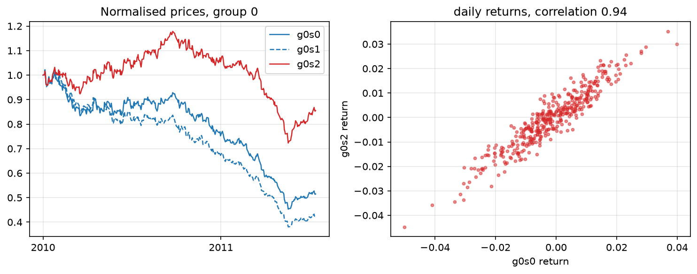
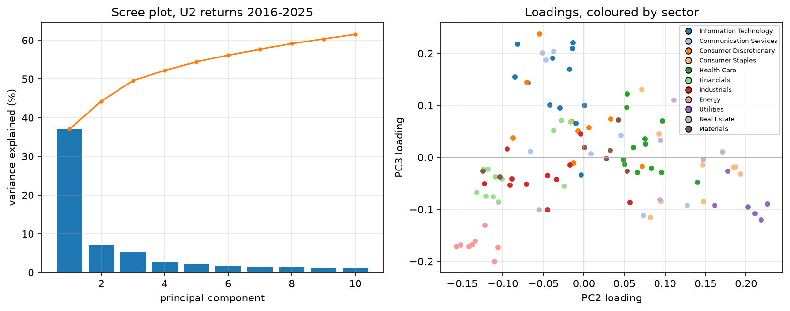
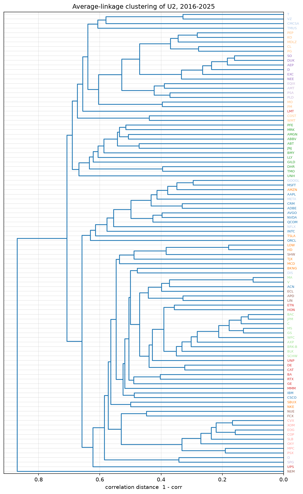
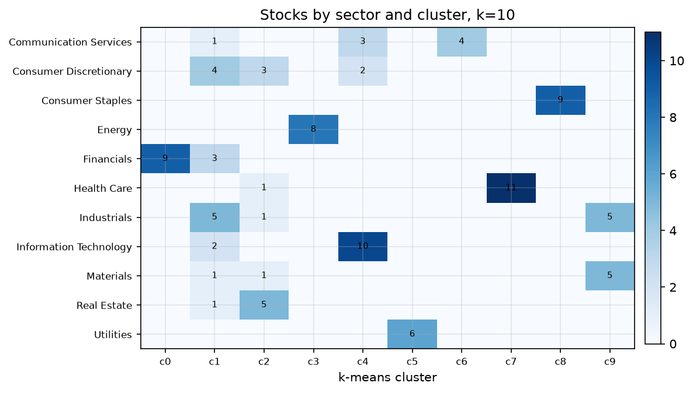
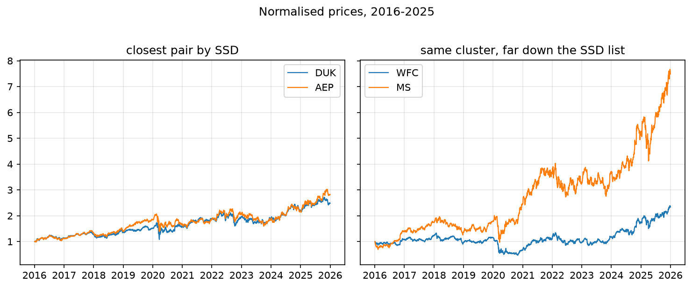
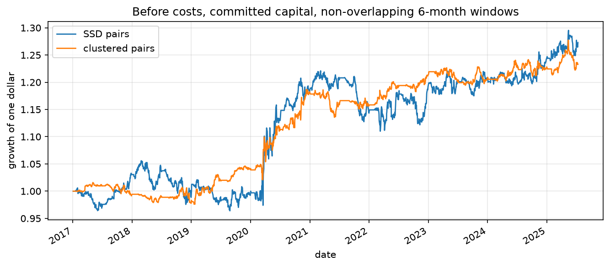

# Module 4 — Choosing pairs by clustering

The distance method pairs stocks whose prices stayed close. Two things follow, and both are awkward. Stocks that move together but have drifted apart never get picked, and low-volatility stocks that simply never separate get picked even when they share no business. This module is the only machine learning on the main path, and it is unsupervised: cluster the stocks by their returns, form pairs inside the clusters, and compare those pairs with the distance-method pairs on the same universe. Clustering finds different pairs. On this data it does not, by itself, make a better backtest.

Notebook: [`notebook.ipynb`](notebook.ipynb). Code: [`statarb/selection.py`](../../src/statarb/selection.py).

> [!TIP]
> **How to read these notes.** The numbered steps are the main path. Boxes are optional: notes and warnings are short asides; collapsed sections (click to expand) hold derivations, extra jargon and interview-level detail.

## Step 1. Recover groups you planted

Simulate three groups of four stocks. Each stock's return is its group's factor plus a little noise, so returns are highly correlated inside a group and uncorrelated across groups. The second half of each group also has a daily drift: the returns still share the factor, but the prices walk away.

```python
pca_features(returns, n_components=3)
kmeans_clusters(embeddings, k=3)
hierarchical_clusters(returns, n_clusters=3)
```

On this draw the first three principal components hold 95% of the variance, and both clusterings recover the three groups exactly (adjusted Rand index 1; the index is 1 when two groupings match and 0 when they match no better than chance).

Inside one group, the two stocks with no relative drift have return correlation 0.94 and a price distance (SSD) of 2.0. The drifted stock has the same correlation, 0.94, and an SSD of 23. `select_pairs` returns a no-drift pair. `candidate_pairs` keeps the drifted one too, because it only looks inside the cluster and ranks by correlation.



**Figure 1.** Left: normalised prices of three stocks that share a factor. The two with no relative drift (blue; one dashed) stay together; the drifted stock (red) separates. Right: daily returns of the drifted pair, correlation 0.94.

**What it means:** SSD measures whether prices stayed close. Correlation measures whether returns moved together. A drift breaks the first and not the second, so the two methods disagree, and here the returns are the ones that carry the group.

## Step 2. PCA on a real universe

U2 is the 100 large caps, adjusted closes from 2016-01-04 to 2025-12-31. Standardise each stock's returns (subtract the mean, divide by the standard deviation), then take principal components. Dates are the observations and stocks are the variables, so each component is a common factor and a stock's coordinates are its **loadings** on those factors.

```math
z_{t,i} = \frac{r_{t,i} - \bar{r_i}}{s_i} .
```

The share of variance by component:

| PC1 | PC2 | PC3 | PC4 | PC5 | PC6 |
|---|---|---|---|---|---|
| 37% | 7.2% | 5.3% | 2.6% | 2.2% | 1.7% |

Every one of the 100 loadings on PC1 is positive. Average loadings on the next two, by sector:

| | PC2 | PC3 |
|---|---|---|
| Utilities | +0.20 | −0.09 |
| Consumer staples | +0.13 | −0.02 |
| Financials | −0.09 | −0.02 |
| Information technology | −0.03 | +0.14 |
| Energy | −0.13 | −0.17 |



**Figure 2.** Left: the first ten components; bars are the variance of each, the line is the cumulative share. Right: each stock's loading on PC2 and PC3, coloured by GICS sector.

**What it means:** PC1 is the market. It moves everyone the same way, and because the loadings sit in a narrow band (0.04 to 0.14) it barely separates one stock from another. The sectors show up in the later components: utilities and staples against energy and financials on PC2, technology against energy on PC3. The sign of a component is arbitrary; flipping it flips the picture and changes nothing.

> [!NOTE]
> k-means below is run on PC2 to PC10, leaving PC1 out, so the clusters are built from the sector components rather than from the market. Including PC1 gives the same groups here, precisely because those loadings are so alike.

## Step 3. k-means, a tree, and the sectors

**k-means** splits the stocks into $k$ groups by putting each stock nearer to its own group's centre than to the others. It needs $k$ in advance. The **silhouette** of a stock is how much closer it is to its own cluster than to the next nearest one; the average over stocks is the score used to pick $k$.

| $k$ | 2 | 4 | 6 | 8 | 10 | 13 |
|---|---|---|---|---|---|---|
| silhouette | 0.17 | 0.20 | 0.26 | 0.35 | 0.38 | 0.39 |

The score rises quickly up to about $k = 8$ and then only from 0.35 to 0.39, so the maximum ($k = 13$) is barely better than its neighbours. The picture below uses $k = 10$, on that plateau.

**Hierarchical clustering** needs no $k$. The distance between two stocks is the correlation distance

```math
d_{ij} = 1 - \mathrm{corr}(r_i, r_j),
```

average linkage merges the closest groups first, and the dendrogram is the record of those merges. A flat cut of the tree into 11 clusters is what gets compared with k-means.



**Figure 3.** Average-linkage dendrogram of U2 on correlation distance. The label colour is the GICS sector. Energy, the banks, health care, utilities and staples each form a block of leaves.



**Figure 4.** How many stocks of each sector fell in each k-means cluster, at $k = 10$. Energy, utilities, health care and staples each land in a single cluster; most of the banks do too.

At $k = 10$, 72% of stocks sit in a cluster whose majority sector is their own, and the adjusted Rand index against GICS is 0.54. The flat cut of the dendrogram agrees less well (adjusted Rand 0.21, 48% majority-sector). The leaves are still the right blocks: what the flat cut gets wrong is mostly sectors that the tree splits across more than one branch.

**What it means:** returns really do cluster by business. GICS was not an input, so the agreement is a check that the clusters mean something, not a target to optimise.

<details>
<summary>The market factor and the flat cut</summary>

Raw correlations are all positive, because every stock loads on PC1. Average linkage therefore spends its first merges on "how market-like is this stock", and a single cut into 11 groups does not land on the sector boundaries. k-means on PC2 to PC10 has had that market component removed, which is why its groups line up with sectors more cleanly. The dendrogram is still the right picture when you want the hierarchy rather than one cut: the industry blocks are there, near the leaves.

</details>

## Step 4. Pairs the distance method never ranks

Over the whole decade there are 4,950 pairs. The closest in normalised price, and two that clustering cares about:

| rank by SSD | pair | correlation | what they are |
|---|---|---|---|
| 1 | DUK, AEP | 0.83 | both utilities |
| 2 | VZ, D | 0.44 | a telecom and a utility |
| 3,608 | WFC, MS | 0.76 | both banks, same k-means cluster |



**Figure 5.** Left: Duke Energy and American Electric Power, the closest pair of the decade. Right: Wells Fargo and Morgan Stanley. Morgan Stanley finished near 7.5 times its starting price, Wells Fargo near 2.3, so the price gap is large even though the returns stay correlated.

**What it means:** SSD's second pair is close in price with a correlation of only 0.44. Low-volatility stocks can stay on top of each other for years without sharing a business. WFC and MS are the opposite: an obvious pair by returns and by cluster, ranked 3,608th out of 4,950 by price distance, because one of them grew much faster. The distance method never looks at them.

> [!WARNING]
> Being in the same cluster means the returns moved together. It does not mean the gap between the prices will close. WFC and MS co-moved and still drifted apart for ten years. Clustering proposes candidates; it is not a test for mean reversion. That test is Module 5.

## Step 5. Same windows, same rule

Every six months, on the previous 252 trading days:

- the distance list is the closest pairs by SSD;
- the cluster list is the most correlated pair inside each k-means cluster, with $k$ that window's own silhouette maximum over $k = 4$ to $12$.

Both lists have the same length. They are traded over the next 126 days with the Module 3 rule: enter at $\pm 2$ formation standard deviations of the normalised-price spread, exit when it crosses zero, one-day lag, average across the pairs. Seventeen windows, from 2017-01-03 to 2025-07-11. The median $k$ is 11. No costs.

One window, formation year 2022, $k = 11$. The distance list, in order:

| pair | SSD | sectors |
|---|---|---|
| MA, V | 0.23 | both financials |
| DHR, TMO | 0.24 | both health care |
| MA, PG | 0.28 | financials, staples |
| JNJ, KO | 0.34 | health care, staples |
| BLK, HD | 0.35 | financials, discretionary |
| ABT, MSFT | 0.37 | health care, technology |

and five more, three of them also across sectors. The cluster list for the same year:

| pair | correlation | sectors |
|---|---|---|
| MA, V | 0.93 | both financials |
| COP, EOG | 0.90 | both energy |
| HD, LOW | 0.90 | both discretionary |
| DHR, TMO | 0.90 | both health care |
| KO, PEP | 0.84 | both staples |
| GOOGL, MSFT | 0.85 | communications, technology |

Ten of the eleven are one sector. MA/V and DHR/TMO are on both lists; COP/EOG, HD/LOW and KO/PEP are not on the distance list at all, because a utility pair and several cross-sector pairs happened to stay closer in price that year.

Across the 17 windows the two lists share only 9% of their pairs. 96% of the clustered pairs are same-sector, against 46% of the SSD pairs.

| Before costs | annual return | annual volatility | Sharpe ratio | same sector |
|---|---|---|---|---|
| SSD pairs | 3.1% | 6.8% | 0.45 | 46% |
| clustered pairs | 2.5% | 3.9% | 0.64 | 96% |



**Figure 6.** Growth of one dollar on committed capital, before costs. The two books share the 2020 jump and then move sideways; the clustered book is the smoother of the two.

**What it means:** clustering does the job it was given. It proposes pairs the distance method ignores, and those pairs are economically recognisable (the oils, the home-improvement retailers, the soft drinks) rather than whichever low-volatility names happened to stay close. It does not, on this universe, produce a reliably higher return. The Sharpe ratios differ by less than their standard error of about 0.4, and the clustered book's advantage is lower volatility, not a higher mean.

> [!WARNING]
> Two caveats before anyone quotes the 0.64. U2 is today's large caps, so the sample is survivorship-biased (Module 1), and there are no transaction costs or borrow fees (Module 6). A Sharpe difference smaller than its error bar is not a result.

<details>
<summary>The error bar on the Sharpe ratio</summary>

For a strategy observed over $Y$ years, a rough standard error of the annualised Sharpe ratio is $\sqrt{(1 + \mathrm{SR}^2 / 2) / Y}$. Here $Y$ is about 8.5, so the error bar is about 0.4 either way. Lo (2002) gives the version that accounts for autocorrelation; this is enough to see that 0.45 and 0.64 are not distinguishable.

</details>

## Step 6. Exercises

Do these in the empty cells at the end of the notebook.

1. **Include the market component.** Rerun k-means on PC1 to PC10 instead of PC2 to PC10 and compare the adjusted Rand index. Why might it barely change?
2. **One pair the distance method ranks last.** Take the clustered pair with the worst SSD rank in a formation window and plot its spread over the following trading window. Does the threshold rule have anything to trade?
3. **A coarser tree.** Cut the dendrogram at a smaller number of clusters and rebuild the candidate pairs. What happens to the same-sector rate, and why?

**Done when:** the clustered-versus-SSD comparison is in the notebook, and you can say what clustering changed and what it did not.

<details>
<summary>Interview questions (4), with key points</summary>

Write your own answer first, then open the key points.

**1. Why cluster before testing pairs? What statistical problem does it reduce?**

<details>
<summary>Key points</summary>

There are 4,950 pairs in a universe of 100 stocks, and testing all of them for mean reversion guarantees false positives (Module 6 makes this precise). Clustering keeps only pairs whose returns actually moved together, which on U2 meant about 11 pairs per window instead of thousands, 96% of them in the same sector. It reduces the search. It does not replace a test: co-movement is not mean reversion.

</details>

**2. What does the first principal component of stock returns represent?**

<details>
<summary>Key points</summary>

The market. On U2 over 2016–2025 it explains 37% of the variance of standardised returns, and every stock loads on it positively. Later components separate sectors (utilities and staples against energy on PC2, technology against energy on PC3). The sign of a component is arbitrary.

</details>

**3. k-means versus hierarchical clustering: when would you pick each?**

<details>
<summary>Key points</summary>

k-means gives a flat partition and needs $k$, chosen here by the silhouette; on the sector components it matched GICS reasonably well (adjusted Rand 0.54 at $k = 10$). Hierarchical clustering on correlation distance gives a tree, so you can cut it at any level and see which groups merge first; use it when the structure is nested. A single flat cut of that tree matched sectors worse (adjusted Rand 0.21), because raw correlations are dominated by the market factor. The industry blocks are still visible at the leaves.

</details>

**4. Did clustering improve your pairs out of sample? Why or why not?**

<details>
<summary>Key points</summary>

It changed which pairs were traded: 9% overlap with the SSD list, 96% same-sector against 46%. Traded with the same threshold rule over 2017–2025, the clustered book returned 2.5% a year with volatility 3.9% (Sharpe 0.64) and the SSD book 3.1% with volatility 6.8% (Sharpe 0.45). The Sharpe difference is smaller than the standard error of about 0.4, there are no costs, and the universe is survivorship-biased. So clustering found more sensible pairs and a smoother book, and it did not demonstrate a higher return.

</details>

</details>

<details>
<summary>Glossary of terms in this module</summary>

| Term | Meaning |
|---|---|
| Principal component | A direction in the data that captures as much variance as possible, orthogonal to the earlier ones |
| Loading | A stock's coordinate on a principal component |
| Scree plot | Variance explained, component by component |
| k-means | Partition into $k$ clusters, each point nearer its own centre than the others |
| Silhouette | How much closer a point is to its own cluster than to the next; used to choose $k$ |
| Hierarchical clustering | Build a tree by successively merging the closest groups |
| Correlation distance | $1 - \mathrm{corr}$ between two return series |
| Dendrogram | The picture of that tree |
| Adjusted Rand index | Agreement between two groupings: 1 when they match, 0 at chance |
| Candidate pair | The most correlated pair inside a cluster |

</details>

<details>
<summary>References and further reading</summary>

- Mantegna, "Hierarchical structure in financial markets", *European Physical Journal B* 11 (1999): correlation distance and a dendrogram of stocks.
- Rousseeuw, "Silhouettes: a graphical aid to the interpretation and validation of cluster analysis", *Journal of Computational and Applied Mathematics* 20 (1987).
- Gatev, Goetzmann & Rouwenhorst, "Pairs trading: Performance of a relative-value arbitrage rule", *Review of Financial Studies* 19(3) (2006): the distance-method benchmark from Module 3.
- Lo, "The statistics of Sharpe ratios", *Financial Analysts Journal* 58(4) (2002): the standard error used in Step 5.

</details>
